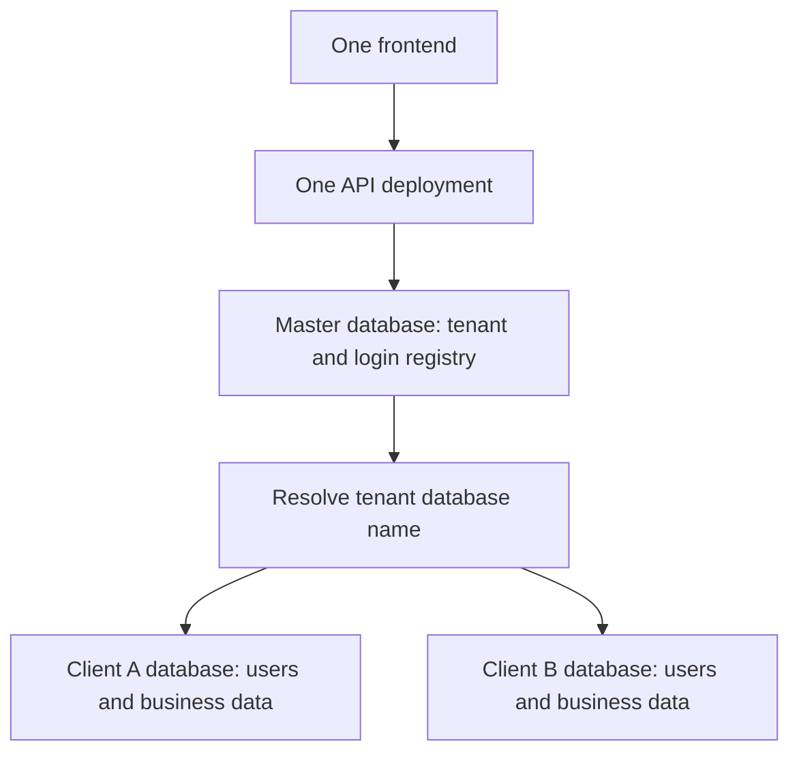

# Meet to Manage: implementation and deployment guide

This guide describes the code in the `meettomanage` frontend and
`meettomanagebackend` backend, including the database-per-tenant implementation.
The deployment examples target one Linux host running Docker, an existing
PostgreSQL server, and an HTTPS reverse proxy. Commands are examples to run during
deployment; creating this document does not deploy or change any server.

## 1. What is built

| Area | Implementation |
| --- | --- |
| Frontend | React, TypeScript and Vite; Nginx serves the compiled SPA. |
| Backend | .NET 9 API, application services, EF Core and PostgreSQL. |
| Existing product | LMS and classroom workflows, users, roles, permissions, admissions, payments, reports, settings, resources and marketing features. |
| Shared registry | `MasterDbContext` stores tenants, tenant database names, globally unique login identifiers, membership and BCrypt PIN hash mirrors. |
| Client databases | `MeetToManageDbContext` retains each client's current users table, profiles, roles, permissions, menus and business records. |
| Provisioning | Platform operator creates a tenant; the API creates, migrates and seeds its database automatically. |
| Login | Unique email/mobile resolves the tenant; the tenant database verifies the user's current PIN and account status. |
| Authorization | JWTs carry tenant ID/code; subsequent requests bind to that registered database. |
| Background work | Workers execute in tenant scopes; a durable outbox reconciles login changes with the shared registry. |
| Isolation | Tenant scopes also cover portal file namespaces, relevant caches, classroom state and SignalR groups. |
| Operator UI | Tenant lifecycle, per-tenant menu management and configuration pages. |

Multi-tenancy is enabled by default. Deploy the application once, then provision
clients through the console without deploying another API or frontend.

### Data ownership



Each user belongs to exactly one tenant. Email/mobile aliases are globally
unique. Roles, permissions and menus remain in each tenant database; the operator
console edits the selected client's menus and settings. There is no shared
business-user/profile database or shared global menu catalogue in this design.

Database names are generated as `mt_<32 hexadecimal characters>`. The master
registry stores the name against the tenant ID. Server credentials come from
backend configuration; the browser never supplies a connection string.

### Login flow

1. The client submits email or mobile and its existing four-digit PIN to
   `POST /api/auth/login`.
2. The API normalizes the identifier and looks up the tenant in master.
3. The API requires an Active tenant and binds its database.
4. The tenant users table verifies the current PIN, lockout and account status.
5. The JWT includes `tenant_id` and `tenant_code`.
6. Later requests validate those claims against master before accessing data.

The tenant users table is authoritative. A stale hash mirror in master does not
authorize an old PIN. An unavailable registry or invalid tenant never causes a
fallback to another client database.

### Administration screens

| URL on the frontend | Purpose |
| --- | --- |
| `/platform/tenants` | Separate operator login; create, retry, suspend, activate and synchronize clients. |
| `/platform/menus` | Select a tenant/portal; create, edit, order, hide and delete menu entries with permission gates. |
| `/platform/configuration` | Select a tenant; manage its settings, including organization, branding, notifications and SEO. |
| `/login` | Client email/mobile and PIN login; tenant is resolved automatically. |
| `/t/client-code/...` | Tenant-bound anonymous pages and links. |

The client Admin profile menu has a **Tenant administration** entry. Opening it
requires a separate platform login: a client Admin token does not grant platform
permissions. The operator's own profile menu links to all three console pages.
Active and Suspended tenants can have their menus/configuration managed.

## 2. Deployment prerequisites

- Check out both repositories at the intended release revisions.
- Use a build machine with .NET 9 SDK and Node.js 22/npm for these examples.
- Provide PostgreSQL connectivity and privileges for master migrations, tenant
  database creation and tenant migrations.
- Provide Docker and a reverse proxy with TLS certificates for the frontend and
  API domains. Use one API replica initially; see the scaling limitations below.
- Provide persistent file storage or configure S3, plus the external integrations
  required by your clients, such as SMTP, payment providers and Jitsi.

Example domains below are `app.example.com` and `api.example.com`. Replace all
example values. Keep production secrets outside Git and container images.

## 3. Prepare PostgreSQL

Connect with `psql` as a PostgreSQL administrator. This example uses the same
tenant role for runtime and provisioning to keep the initial setup simple:

```sql
CREATE ROLE mtm_master LOGIN;
\password mtm_master
CREATE ROLE mtm_tenant LOGIN CREATEDB;
\password mtm_tenant
CREATE DATABASE meettomanage_master OWNER mtm_master;
```

The `\password` commands prompt for passwords. Ensure PostgreSQL network access
allows the API host. No client database needs to be manually created.

For separate provisioning credentials, set `ConnectionStrings__TenantProvisioning`.
That role needs CREATEDB, access to the `postgres` database and permission to
assign database ownership to the `TenantServer` username. Both tenant connection
strings must address the same PostgreSQL server. Tenant runtime credentials need
the privileges used by migrations in their databases.

## 4. Build the backend and generate the operator password hash

Run from the backend repository on a Linux build machine:

```bash
dotnet restore iucs.meettomanage.api.sln
dotnet test iucs.meettomanage.api.sln -c Release --no-restore
dotnet publish iucs.meettomanage.api/iucs.meettomanage.api.csproj \
  -c Release -o /tmp/mtm-api-publish
dotnet /tmp/mtm-api-publish/iucs.meettomanage.api.dll platform-password-hash
```

Enter a platform password of at least 12 characters. Store the resulting BCrypt
hash in the secret configuration below. This is separate from client PINs.

The backend Dockerfile now copies all referenced project files before restoring,
so `docker build -f iucs.meettomanage.api/Dockerfile .` works from the repository
root. The following alternative runtime-image build uses the published output
instead, when you have already built on a separate machine:

```bash
docker build -t meettomanage-api:release -f - /tmp/mtm-api-publish <<'DOCKERFILE'
FROM mcr.microsoft.com/dotnet/aspnet:9.0
WORKDIR /app
COPY . .
USER app
EXPOSE 8080
ENTRYPOINT ["dotnet", "iucs.meettomanage.api.dll"]
DOCKERFILE
```

Use an immutable release tag in a real release process so the previous image can
be identified for rollback.

## 5. Configure backend production settings

Create `/etc/meettomanage/backend.env` on the deployment host with the following
contents, replacing placeholders. Restrict this file to the deployment operator
(for example, `chmod 600 /etc/meettomanage/backend.env`).

```dotenv
ASPNETCORE_ENVIRONMENT=Production
ASPNETCORE_URLS=http://+:8080
MultiTenancy__Enabled=true
ConnectionStrings__MasterDb=Host=DB_HOST;Port=5432;Database=meettomanage_master;Username=mtm_master;Password=REPLACE_MASTER_PASSWORD
ConnectionStrings__TenantServer=Host=DB_HOST;Port=5432;Database=postgres;Username=mtm_tenant;Password=REPLACE_TENANT_PASSWORD;Maximum Pool Size=20
MultiTenancy__PlatformAdmin__Email=platform-admin@example.com
MultiTenancy__PlatformAdmin__PasswordHash=REPLACE_WITH_GENERATED_BCRYPT_HASH
Jwt__SigningKey=REPLACE_WITH_A_RANDOM_SECRET_OF_AT_LEAST_32_BYTES
Database__MigrateOnStartup=true
Frontend__BaseUrl=https://app.example.com
Api__BaseUrl=https://api.example.com
Cors__AllowedOrigins__0=https://app.example.com
Storage__Provider=Local
Storage__LocalPath=/app/uploads
```

Use the literal BCrypt hash without surrounding quotes in this Docker env file.
Pass it with `--env-file`; do not `source` the file into a shell. Add indexed CORS
origins for any additional actual frontend domains. The repository default is
`*`, so overriding it for production is required.

Add optional `ConnectionStrings__TenantProvisioning` only if using a separate
provisioning role. Add your actual SMTP, S3, payment and Jitsi settings using the
existing configuration sections where those integrations are required. For S3,
configure `Storage__Provider=S3` and the `Storage__S3` endpoint, bucket and
credentials. Configure any existing per-client storage selection through that
client's settings workflow.

`ConnectionStrings__ReaderNestDb` alone is insufficient in production tenant
mode. The localhost Development fallback does not run in Production. Do not
import live data into the master database.

## 6. Start the API

```bash
sudo install -d -o 1654 -g 1654 /opt/meettomanage/uploads
docker run -d --name meettomanage-api \
  --restart unless-stopped \
  --env-file /etc/meettomanage/backend.env \
  -p 127.0.0.1:1002:8080 \
  -v /opt/meettomanage/uploads:/app/uploads \
  meettomanage-api:release
docker logs --tail 100 meettomanage-api
curl --fail http://127.0.0.1:1002/health
```

The directory owner above matches the .NET image's `app` user. Adapt ownership
if using a different runtime UID. Keep the mount across redeployments, including
when S3 is selected, if clients use or may switch to local storage.

Startup migrates master and initializes Active tenants when migration-on-startup
is enabled. New tenant provisioning always applies its business migrations.
`/health` is a basic process endpoint; it does not prove tenant database access,
provisioning, SMTP or other integrations work.

## 7. Build and start the frontend

In the frontend repository, set the actual public endpoints in `.env.production`:

```dotenv
VITE_API_BASE_URL=https://api.example.com
VITE_JITSI_DOMAIN=meet.example.com
```

The existing production file currently points to `api.meettomanage.cloud` and
`meet.meettomanage.cloud`. Keep those only if they are your intended deployment.
Vite embeds these values at build time; changing container runtime environment
variables does not change the built frontend.

```bash
npm ci
npx vitest run
docker build --build-arg BUILD_MODE=production -t meettomanage-web:release .
docker run -d --name meettomanage-web \
  --restart unless-stopped -p 127.0.0.1:1001:80 \
  meettomanage-web:release
```

For UAT, review `.env.uat` and build with `BUILD_MODE=uat`. Its current domains
are different from the production domains.

## 8. Configure HTTPS and the reverse proxy

Forward `app.example.com` to `127.0.0.1:1001` and `api.example.com` to
`127.0.0.1:1002`. If your proxy is itself a container, use a shared Docker network
and container names instead of its own loopback address.

- Terminate TLS and forward the original Host, client IP and protocol headers.
- Preserve API paths, including `/t/client-code/api/...` and query strings.
- Enable WebSocket upgrades for SignalR and use suitable connection timeouts.
- Allow request sizes/timeouts appropriate to your resource upload workflows.
- Serve frontend deep links through `index.html`; the supplied frontend
  `nginx.conf` already provides this fallback.
- If the Jitsi domain changes, update the domain-specific Permissions-Policy in
  frontend `nginx.conf` and verify camera/microphone access in the browser.

The API trusts forwarded headers from its immediate proxy hop. Keep the API's
internal HTTP port restricted to the proxy, as in the loopback bindings above.

## 9. Create the first client

1. Open `https://app.example.com/platform/tenants`.
2. Sign in using the configured operator email and the original password used
   to generate the BCrypt hash.
3. Create a client with a unique code, display name, globally unique admin email
   and four-digit initial PIN. Codes start with a lowercase letter, followed by
   lowercase letters, digits or hyphens; total length is 3 to 50 characters.
4. Confirm its status becomes Active. The generated database has migrations,
   roles, menus, settings and the initial client administrator.
5. Log in through `/login` with that client's email and PIN.
6. In the operator console, select the client on the menu/configuration pages
   and make the required changes.

**Using an existing database.** The create form has an optional *Existing database
name*. Leave it empty to get a generated `mt_<hex>` database. If you enter a name
(lowercase letters, digits, underscores; not `postgres`, `template0/1` or the master
database) that already exists on the tenant server, the database is kept as-is and only
its missing migrations are applied; if it does not exist it is created. For an existing
database no administrator is seeded and no PIN is reset, and the client is left
**Suspended**: run **Sync imported logins**, then activate it. A new database still
requires the administrator email and PIN.

Failed provisioning retains the database for diagnosis. Check API logs and use
Retry with the intended original administrator details. The management API does
not provide a tenant database deletion operation.

## 10. Import existing live data

1. Back up the source database and files. Provision the destination tenant, then
   suspend it before importing.
2. Identify its generated database from master:

   ```sql
   SELECT "Id", "Code", "DatabaseName"
   FROM tenants WHERE "Code" = 'client-code';
   ```

3. Plan a data import into that tenant database. Provisioning already seeds data,
   so reconcile seeded rows and relationships rather than blindly appending a
   complete dump. Preserve business relationships and globally unique user IDs.
4. Apply all business migrations to the imported database. When using EF CLI,
   explicitly set `ConnectionStrings__ReaderNestDb` to this destination and use
   `--context MeetToManageDbContext`; that design-time factory does not infer the
   destination from a tenant code. The shared context uses
   `ConnectionStrings__MasterDb` and `--context MasterDbContext`.
5. Migrate files and stored references into this tenant's namespace. Local roots
   use `<tenant-id-without-hyphens>/`; portal S3 keys use the corresponding
   `<tenant-id-without-hyphens>-` prefix. Old flat keys are not assigned automatically.
6. Run **Sync imported logins** while the tenant is Suspended. Resolve conflicting
   emails/mobiles before activating it.
7. Activate and verify representative accounts, records, files and permissions.

Do not overwrite master with a live client database. A fresh deployment does not
automatically discover or import existing business data.

## 11. Deployment acceptance checks

- Open `/platform/tenants`, `/platform/menus` and `/platform/configuration`
  directly and refresh each page.
- Create two test clients; verify each admin's email/mobile login resolves the
  correct tenant. Duplicate normalized email/mobile registration must fail.
- Verify a client token cannot access operator endpoints or another tenant's data.
- Change a menu and setting for one client; confirm the other stays unchanged.
- Suspend a client, confirm requests are rejected, then reactivate it.
- Verify uploads/downloads and classroom real-time connections for each client.
- Test tenant-prefixed public links, PIN resets, guest/calendar/payment flows
  and callbacks with real integration configuration.
- Restart the deployment and verify persisted data/files and client logins.

Example payment callback URLs:

```text
https://api.example.com/t/client-code/api/payments/webhook/razorpay
https://api.example.com/t/client-code/api/payments/webhook/cashfree
```

Old unprefixed public links must be regenerated or explicitly redirected. The
application does not search all client databases to guess a tenant.

## 12. Jenkins and Compose configuration

Both Jenkinsfiles check out the `DeepakVijayasarathi/meettomanage` and
`DeepakVijayasarathi/meettomanagebackend` repositories. The backend `Jenkinsfile`
passes the multi-tenant settings (MasterDb, TenantServer, platform operator
email/hash, migrations, frontend/API URLs and an exact CORS origin) and fails
unless `/health` answers on port 2200. `docker-compose.prod.yml` has the same
settings. Before the first run:

| Item | Action |
| --- | --- |
| Master database | Create an empty `meettomanage_master` database on the server; the API migrates it. The `DB_USER` role must have CREATEDB because it also creates client databases. |
| Backend Jenkinsfile values | Replace the example `FRONTEND_BASE_URL`, `API_BASE_URL` and `PLATFORM_ADMIN_EMAIL`. |
| Jenkins credentials | Create Secret text credentials listed at the bottom of the backend `Jenkinsfile`: `meettomanage-db-password`, `-jwt-signing-key`, `-s3-access-key`, `-s3-secret-key`, `-ssh-password-server0/1`, `-platform-admin-hash` (BCrypt hash from `platform-password-hash`) and optionally `-gemini-api-key`. |
| Secrets in Git | The Jenkinsfile holds no secret values. Rotate any secret that was previously committed or pasted into a Jenkinsfile. |
| Compose `.env` | Set `PLATFORM_ADMIN_EMAIL`, `PLATFORM_ADMIN_PASSWORD_HASH` (write each `$` in the hash as `$$`), `PORTAL_ORIGIN` and `API_ORIGIN`. |
| Frontend build | Review production/UAT domain values. The frontend `nginx.conf` Permissions-Policy allows both `meet.meettomanage.cloud` and `thereadernest.co.in`; edit it if your Jitsi domain differs. |

## 13. Operations, upgrades and current limits

- Back up master, every tenant database and all relevant file namespaces. Record
  tenant-to-database mappings with recovery material and test restoring them.
- Before upgrading, retain previous image tags and back up databases. Startup
  migrations may change schemas; reverting an image alone does not undo them.
- Monitor provisioning errors, registry connectivity and directory outbox failures.
  A failed business write can leave an identifier reservation; suspend the tenant
  and rebuild its directory with **Sync imported logins** after diagnosis.
- Workers discover Active tenants approximately every 15 seconds; the directory
  worker retries queued changes approximately every five seconds.
- Start with one API instance. Background jobs are process-local and multiple
  replicas require job coordination. Classroom/SignalR in-memory state needs a
  separate scale-out design or the existing single-instance arrangement.
- Shared server monitoring, SSH controls and database-backup screens are blocked
  for client sessions in tenant mode. Operate infrastructure outside client menus.
- Operator credentials currently come from configuration; the console does not
  implement a database-backed operator account management system.

For implementation details and isolated integration-test commands, see
[MULTI_TENANCY.md](MULTI_TENANCY.md). Key backend code is under
`iucs.meettomanage.api/Tenancy`, `Controllers/Platform*`, and
`iucs.meettomanage.domain/Data/MasterDbContext.cs`; frontend console code is under
`src/features/platform` in the frontend repository.
